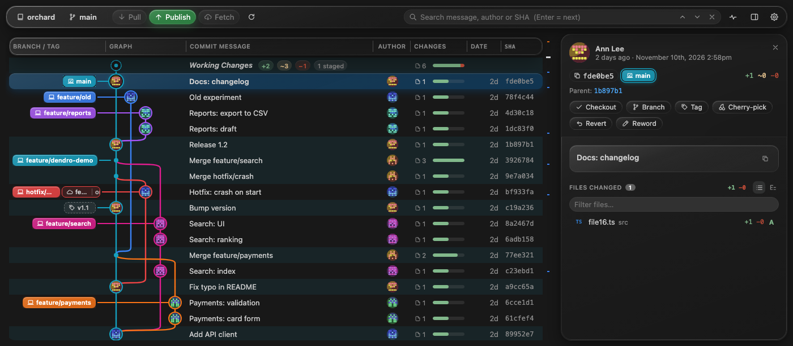
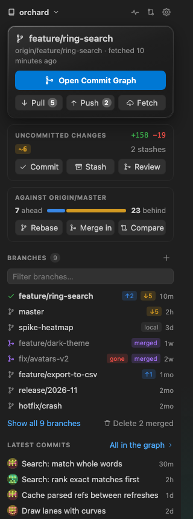
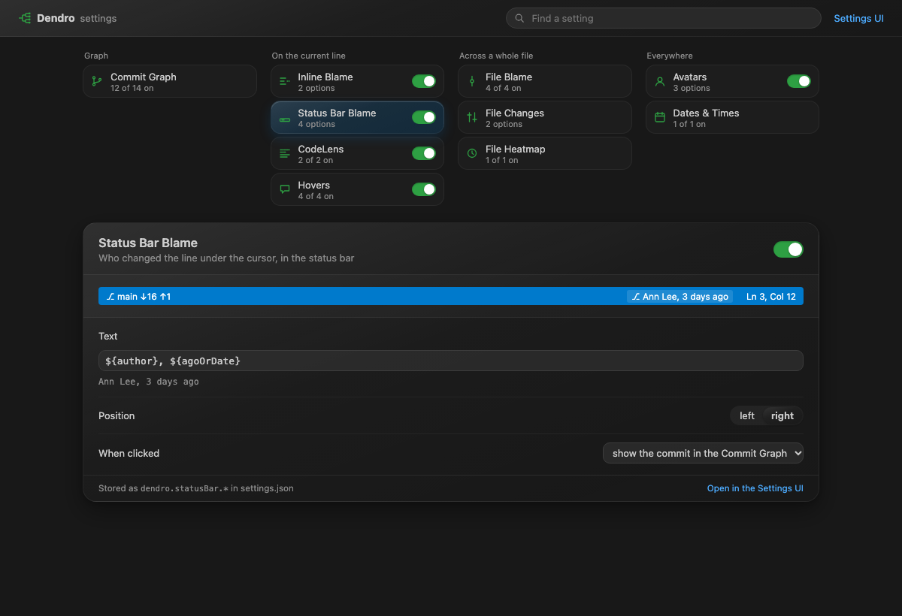

# Dendro

Dendrochronology reads a tree's history from its rings. Dendro reads your git tree: a commit graph, blame in the
editor and the history of every file, for VS Code and the editors built on it, such as Cursor.

Free and open source, with no account and no server of its own. Dendro works through the editor's built-in Git
extension; the only requests it makes itself are avatar lookups, which you can switch off.



## Commit Graph

**Dendro: Show Commit Graph**, or the Dendro icon in the activity bar.

- Lanes for every branch, merges, local / remote / tag badges with ahead and behind counts, uncommitted changes on top.
- Columns you resize, reorder by dragging and hide: Branch / Tag, Graph, Message, Author, Changes, Date, SHA.
- Pull, Push, Fetch and Publish from the toolbar; automatic fetch in the background.
- Click a commit for its details: author, dates, parents, message and changed files with `+ / −`; click a file for its diff.
- Actions on a commit: checkout, create a branch or a tag, cherry-pick, revert, reset, edit the message.
- Drag a branch badge onto another to merge or rebase.
- Cmd/Ctrl+click a second commit to compare the two.
- Search by message, author or SHA; search hits and branch tips marked on the scrollbar.
- A card with the author, files and changed lines when the pointer rests on a row.
- Open it as an editor tab or in the bottom panel next to the terminal.

## Side bar



**Overview** shows where the current branch stands and the buttons that act on it:

- Pull / Push / Fetch with counts, and how far the branch is from the default branch, with Rebase, Merge in and Compare.
- Uncommitted changes with Commit, Stash and Review.
- Local branches with a filter: checkout, compare, merge or delete from the row; delete every merged branch at once.
- The latest commits, each one a click away from the graph.

Below it: Remotes, Tags, Stashes, Worktrees, Contributors, **File History** and **Line History** of the file you edit.

<br clear="right">

## In the editor

- Blame after the current line and in the status bar.
- Blame cards on hover with the full message, links and the diff of the line.
- CodeLens above files, classes and functions: the latest change and how many people wrote the block.
- File annotations from the editor title: **File Blame**, **File Heatmap** (how recently each line changed) and
  **File Changes** (lines not committed or not pushed yet).

## More

- **Compare** two branches, tags or commits: the commits on each side and the files that differ.
- **Interactive rebase** editor: drag to reorder; pick, reword, squash, fixup or drop each commit.
- **Visual File History**: authors over time and the lines changed by each commit of a file.
- **Repository Insights**: a year of commits as a calendar, streaks, contributors, the most changed files, commit hours.

## Settings



**Dendro: Open Settings**, or the gear in the graph toolbar. Every part of Dendro has a tile with its switch, and the
open one shows a live preview of what you change. Values go to your `settings.json` under `dendro.*`.

## Avatars

Account pictures come from GitHub, GitLab and Gravatar and are cached for a week. Gravatar receives an MD5 hash of the
author's email; turn any source off in the settings. A private GitLab shows pictures only with a token: run
**Dendro: Connect GitLab for Avatars** (a token with the `read_user` scope, kept in the editor's secret storage).

## Build from source

```sh
npm install
npm test          # graph layout and git output parsers
npm run package   # builds dendro.vsix
```

Install the file with **Extensions: Install from VSIX…**, or `code --install-extension dendro.vsix`
(`cursor --install-extension dendro.vsix` for Cursor). `npm run watch` rebuilds on change; reload the window to pick up
a new build.

## License

[MIT](LICENSE)
